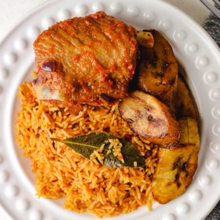

# NAIJA POT KITCHEN & GRILL LTD — Website & cPanel Deployment Package

Official website package for **NAIJA POT KITCHEN & GRILL LTD**, specializing in authentic Nigerian cuisine, smoky suya grills, rich soups, and fresh bakery pastries in Milton Keynes, United Kingdom.

---

## 1. Quick Brand Specifications

- **Company Name:** NAIJA POT KITCHEN & GRILL LTD
- **Location:** Milton Keynes, United Kingdom (MK13 Area)
- **WhatsApp Direct Ordering:** `+44 7342 229865` (`https://wa.me/447342229865`)
- **Direct Telephone Line:** `+44 7444 614764` (`tel:+447444614764`)
- **Official Instagram:** [https://www.instagram.com/naijapotkitchen_grill_mk](https://www.instagram.com/naijapotkitchen_grill_mk)
- **Official TikTok:** [https://www.tiktok.com/@naija.pot.kitchen](https://www.tiktok.com/@naija.pot.kitchen)
- **Official Facebook Placeholder:** `https://www.facebook.com/naijapotkitchen` *(configurable)*
- **Original Canva Logo Link:** [https://canva.link/8dxbvb02llqmoza](https://canva.link/8dxbvb02llqmoza)

---

## 2. Technology Stack & cPanel Compatibility

- **Pure Client-Side Architecture:** Standard HTML5, CSS3, and Vanilla JavaScript.
- **Zero Server Runtimes Required:** Does **NOT** require Node.js, React, npm, Vite, Webpack, Docker, or command-line access on the production host.
- **cPanel Shared Hosting Ready:** Designed for immediate deployment into standard Apache / LiteSpeed / Nginx `public_html` directories.
- **Relative Path Architecture:** Supports installation at the root domain (`https://naijapotkitchen.co.uk/`) or within any subfolder (e.g., `https://yourdomain.com/naijapot/`).

---

## 3. Package File Directory Structure

```
naija-pot-kitchen-grill/
│
├── index.html               # Main homepage (Hero, carousel, visit, categories, featured, story, reviews)
├── about.html               # Our Story, Nigerian culinary heritage, philosophy & values
├── menu.html                # Full menu with interactive soup/protein solid-dish builder
├── bakery.html              # Fresh Agege bread, meat pies, pastries, and cakes
├── contact.html             # Opening hours, direct calling, WhatsApp enquiry generator, map
├── privacy-policy.html      # UK GDPR & Data Protection compliance policy
├── styles.css               # Primary responsive stylesheet
├── script.js                # Vanilla JavaScript interactions
├── robots.txt               # Search engine crawler instructions
├── sitemap.xml              # XML Sitemap for search engines
├── favicon.ico              # Browser tab icon (64x64 PNG format)
├── favicon.svg              # Scalable vector favicon
│
├── images/                  # All local food photos, drinks, and logo assets
│   ├── logo.png             # NAIJA POT KITCHEN & GRILL LTD official brand logo
│   ├── logo.svg             # Vector brand logo
│   ├── hero-jollof.jpg      # Hero slider dish
│   ├── pounded-yam-egusi.jpg# Pounded Yam & Egusi
│   ├── amala-assorted.jpg   # Amala with Assorted Meat
│   ├── efo-riro.jpg         # Efo Riro Stew
│   ├── restaurant.jpg       # Dining room presentation
│   └── drinks/              # Soft drinks and traditional beverages
│
├── assets/
│   ├── images/              # Mirror image directory for cPanel asset conventions
│   └── icons/               # SVG social icons (Facebook, Instagram, TikTok, WhatsApp, Phone)
│
├── css/
│   └── style.css            # Mirror stylesheet for conventional asset subfolder structures
│
├── js/
│   └── main.js              # Mirror script for conventional asset subfolder structures
│
└── README.md                # This comprehensive installation guide
```

---

## 4. Step-by-Step cPanel Deployment Guide

Follow these steps to upload and launch the website on any cPanel shared hosting account:

### Step 1: Download the Website Archive
Download the complete `naija-pot-kitchen-grill.zip` archive provided with this deliverable.

### Step 2: Log In to cPanel
Navigate to your hosting provider's cPanel login URL (e.g., `https://yourdomain.com:2083` or through your hosting dashboard like Namecheap, Bluehost, GoDaddy, SiteGround, cPanel Host).

### Step 3: Open File Manager
Under the **Files** section, click on **File Manager**.

### Step 4: Navigate to the Document Root
- For your **primary domain**, double-click to enter the `public_html/` directory.
- For an **addon domain** or **subdomain**, navigate to the document root folder assigned to that domain.
*(Ensure any old placeholder files like `default.html` or `index.php` are backed up or removed if you want this website to take over immediately).*

### Step 5: Upload the ZIP File
1. Click the **Upload** button in the File Manager top toolbar.
2. Select or drag-and-drop `naija-pot-kitchen-grill.zip`.
3. Wait for the upload progress bar to turn green (100%).

### Step 6: Extract the Archive
1. Return to the File Manager window and click **Reload**.
2. Right-click on `naija-pot-kitchen-grill.zip` and choose **Extract**.
3. Set the target destination as `/public_html/` and click **Extract File(s)**.
4. Verify that `index.html` is located directly inside `public_html/` (not nested inside a duplicate folder).

### Step 7: Verify SSL / HTTPS
1. In cPanel, find **SSL/TLS Status** or **Let's Encrypt SSL**.
2. Ensure an active SSL certificate is installed for your domain.
3. Enable **Force HTTPS Redirection** under cPanel **Domains** settings.

---

## 5. Testing & Verification Checklist

Once uploaded, verify all interactive elements on both desktop and mobile:

| Feature | Expected Action / Verification |
| :--- | :--- |
| **Homepage Hero** | Rotating slides with crossfade animations for Nigerian delicacies. |
| **WhatsApp Buttons** | Opens WhatsApp to `+44 7342 229865` with prefilled order text. |
| **Direct Call Buttons** | Triggers the phone dialler with `+44 7444 614764`. |
| **Instagram Link** | Opens `https://www.instagram.com/naijapotkitchen_grill_mk` in a new tab. |
| **TikTok Link** | Opens `https://www.tiktok.com/@naija.pot.kitchen` in a new tab. |
| **Solid Dish Modal** | Clicking any soup/swallow opens the interactive builder (Soup, Protein, Extra selection). |
| **Mobile Sticky Bar** | Quick WhatsApp and Phone dialler buttons remain pinned at bottom on screens < 768px. |
| **Zero Broken Assets** | 100% of images are served from local hosting without external CDN dependencies. |

---

## 6. How to Customize the Website

### Updating the Facebook URL
Open `index.html`, `about.html`, `menu.html`, `bakery.html`, `contact.html`, and `privacy-policy.html`. Search for:
```html
https://www.facebook.com/naijapotkitchen
```
Replace it with your official Facebook Page URL.

### Replacing the Brand Logo
The logo is located at `images/logo.png` (and `assets/images/logo.png`).
- To use an updated export directly from Canva ([https://canva.link/8dxbvb02llqmoza](https://canva.link/8dxbvb02llqmoza)), simply export a transparent PNG from Canva and overwrite `images/logo.png`.
- The HTML automatically adjusts to the logo's aspect ratio without stretching or distortion.

### Modifying Menu Items & Prices
Open `menu.html`. Search for any dish name (e.g., `Jollof Rice`).
Each dish card is cleanly structured:
```html
<div class="dish-card">
  <div class="dish-card-media"></div>
  <div class="dish-card-body">
    <div class="dish-name">Smoky Jollof Rice with Fried Plantain</div>
    <p class="dish-desc">Slow-cooked over hardwood smoke, served with dodo and tender meat.</p>
    <div class="dish-footer">
      <span class="dish-price">&pound;15.00</span>
      <a href="https://wa.me/447342229865?text=Hello%20NAIJA%20POT%20KITCHEN%20%26%20GRILL%20LTD%2C%20I%20would%20like%20to%20order%20Smoky%20Jollof%20Rice%20&pound;15.00" class="order-btn" target="_blank">Order</a>
    </div>
  </div>
</div>
```
Simply edit the text and price, and update the price in the WhatsApp link to match.

### Setting the Live Domain in Sitemap & SEO
When your production domain is active, update `sitemap.xml` and the canonical URLs in the `<head>` of each HTML file from `https://naijapotkitchen.co.uk/` to your registered domain.

---

## 7. Security & Privacy Notes

- No backend database or secret API keys are required for normal operation.
- External links use `rel="noopener noreferrer"` to prevent tab-napping vulnerabilities.
- User data submitted via the contact form is directly routed to WhatsApp using client-side URL encoding, preventing database exposure or unauthorized data retention on the web server.

---

&copy; 2026 NAIJA POT KITCHEN & GRILL LTD. All Rights Reserved.
